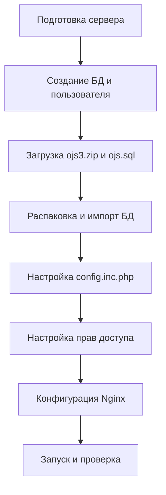

# План развертывания OJS 3 на VDS (Ubuntu 24.04)

Этот документ описывает шаги по переносу проекта Open Journal Systems (OJS) с локальной машины на сервер.

## Архитектура системы
- **ОС:** Ubuntu 24.04 LTS
- **Веб-сервер:** Nginx
- **База данных:** MySQL
- **Интерпретатор:** PHP 8.3-FPM

## Схема процесса (Mermaid)


## Детальные шаги

### 1. Подготовка базы данных
Необходимо войти в MySQL под root и выполнить:
```sql
CREATE DATABASE ojs DEFAULT CHARACTER SET utf8 COLLATE utf8_general_ci;
CREATE USER 'ojsuser'@'localhost' IDENTIFIED BY 'vash_parol';
GRANT ALL PRIVILEGES ON ojs.* TO 'ojsuser'@'localhost';
FLUSH PRIVILEGES;
```

### 2. Перенос файлов
Используйте `scp` или SFTP клиент (например, FileZilla):
- Загрузить [`ojs3.zip`](d:/artur/Задачи/ojs3/ojs3.zip) в `/var/www/`
- Загрузить [`ojs.sql`](d:/artur/Задачи/ojs3/ojs.sql) в домашнюю директорию

### 3. Развертывание
```bash
cd /var/www
sudo unzip ojs3.zip -d ojs
sudo chown -R www-data:www-data ojs
mysql -u ojsuser -p ojs < ~/ojs.sql
```

### 4. Настройка прав и директорий
OJS требует отдельную директорию для файлов вне веб-корня:
```bash
sudo mkdir /var/www/ojs_files
sudo chown www-data:www-data /var/www/ojs_files
sudo chmod 770 /var/www/ojs_files
```
Права внутри проекта:
- `cache/` — 775
- `public/` — 775
- `config.inc.php` — 644 (после настройки)

### 5. Конфигурация Nginx
Создать файл `/etc/nginx/sites-available/ojs`:
```nginx
server {
    listen 80;
    server_name your_domain.com;
    root /var/www/ojs;
    index index.php;

    location / {
        try_files $uri $uri/ /index.php?$args;
    }

    location ~ \.php$ {
        include snippets/fastcgi-php.conf;
        fastcgi_pass unix:/var/run/php/php8.3-fpm.sock;
    }
}
```

## Следующие шаги
После подтверждения плана мы перейдем в режим **Code** для пошаговой реализации через консоль.